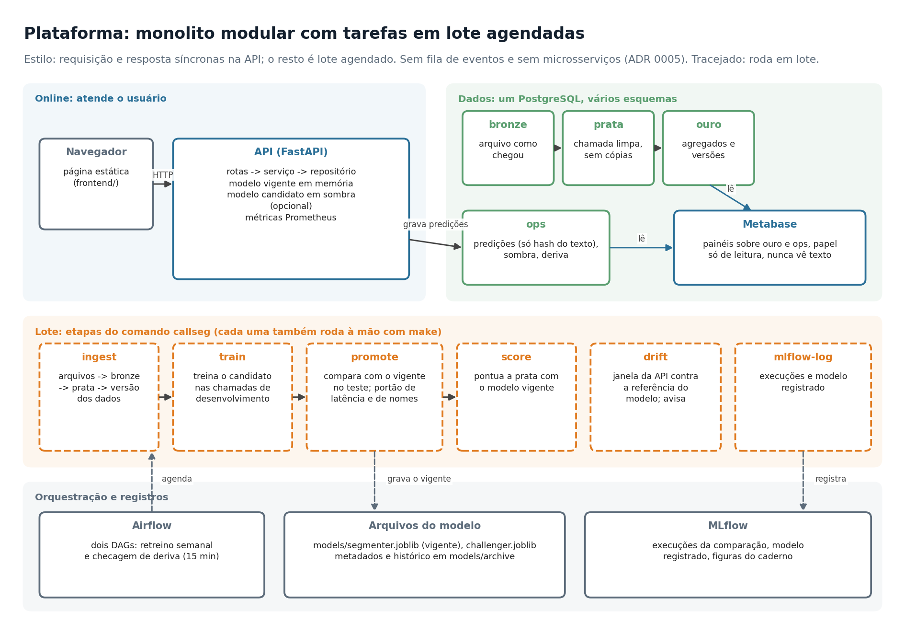

# Callseg: setor e subgrupo de cada chamada de call center

Dada a transcrição completa de uma chamada, o serviço devolve:

1. o **setor** (`automotive`, `home_service` ou `medicare`), por um classificador supervisionado;
2. o **subgrupo** dentro desse setor (por exemplo, "Pet: creche, reservas e conta"), descoberto sem rótulo por agrupamento.

Ao redor do modelo há uma API, uma página de demonstração, um banco em camadas, painéis de BI, rastreio de experimentos e um pipeline de retreino com portão de promoção. Os números de desempenho estão em [`docs/reports/MODEL_CARD.md`](docs/reports/MODEL_CARD.md).



## Projeto no ar

| O quê | Endereço |
|---|---|
| Página de demonstração (cole uma transcrição ou arraste o JSON da chamada) | https://callseg.waynefoundations.com/demo/ |
| Documentação interativa da API | https://callseg.waynefoundations.com/docs |
| Painéis de BI (Metabase): hub | https://bi.waynefoundations.com/ |
| Painel de dados | https://bi.waynefoundations.com/dados |
| Painel de modelos e subgrupos | https://bi.waynefoundations.com/modelos |
| Painel de operação | https://bi.waynefoundations.com/operacao |
| MLflow (experimentos e modelo registrado), com senha | https://mlflow.waynefoundations.com/ |
| Airflow (retreino e deriva), com senha | https://mlflow.waynefoundations.com/airflow/ |
| Código | https://github.com/pcmoraesmenezes/callseg |

O MLflow e o Airflow ficam atrás de senha porque quem entra pode apagar execuções e modelos; a senha é passada a quem pedir. Os endereços são de uma instalação pessoal e podem sair do ar.

## Começar

Requisitos: Docker e [uv](https://docs.astral.sh/uv/). O dataset (`data/<setor>/*.json`) não vem no repositório.

```bash
cp .env.example .env            # troque as senhas
make install                    # ambiente Python com uv
make test                       # testes, sem dataset
make up                         # banco, migrações e API em http://127.0.0.1:8010
make ingest train promote       # dados -> modelo (com o dataset em data/)
```

- Página de demonstração: `http://127.0.0.1:8010/demo/`
- Documentação interativa da API: `http://127.0.0.1:8010/docs`
- Todos os comandos: `make help`

## Onde encontrar cada coisa

| Quero... | Vá para |
|---|---|
| entender a modelagem e os testes feitos | [`notebooks/experimentacao.ipynb`](notebooks/experimentacao.ipynb) |
| ver o desempenho, limitações e riscos | [`docs/reports/`](docs/reports/) (model card e pré-mortem) |
| entender por que cada escolha foi feita | [`docs/adr/`](docs/adr/) |
| ver a arquitetura e os diagramas | [`docs/architecture/`](docs/architecture/) |
| operar: retreinar, monitorar, implantar | [`docs/guides/operacao.md`](docs/guides/operacao.md) e [`deploy/README.md`](deploy/README.md) |
| saber o que cada arquivo de infraestrutura faz | [`docs/guides/infraestrutura.md`](docs/guides/infraestrutura.md) |
| entender o CI e as Actions | [`docs/guides/ci-cd.md`](docs/guides/ci-cd.md) |
| mexer no código | [`docs/guides/desenvolvimento.md`](docs/guides/desenvolvimento.md) |

## API

`POST /segment` recebe o JSON da chamada; só o campo `text` é lido, então o arquivo do dataset pode ser enviado inteiro.

```bash
curl -s "localhost:8010/segment?explain=true" -H 'Content-Type: application/json' \
  -d '{"text": "Thank you for calling. I need to book my dog for boarding next weekend..."}'
```

| Rota | Para que serve |
|---|---|
| `POST /segment` | uma chamada: setor, subgrupo, confiança, evidência (`?explain=true`) |
| `POST /segment/batch` | até 50 chamadas, resposta na mesma ordem |
| `GET /subgroups` | catálogo dos subgrupos de cada setor |
| `GET /recent` | últimas segmentações (só metadados) |
| `GET /health` | versão do modelo vigente e do candidato em sombra |
| `GET /metrics` | métricas Prometheus |

Campos que merecem atenção na resposta: `low_confidence` (probabilidade do setor abaixo do limiar), `subgroup.ambiguous` (atribuição frágil, margem pequena para o segundo grupo), `evidence` (termos que sustentam a decisão) e `warnings` (`transcricao_curta` com menos de 100 palavras). O texto da chamada nunca é gravado nem registrado em log: só o hash.

## Ciclo de vida do modelo

```
make ingest      arquivos -> bronze -> prata -> versão do conjunto de dados
make train       treina o candidato com as chamadas de desenvolvimento
make promote     compara com o vigente no teste; promove se o portão deixar
make score       pontua a prata com o modelo vigente (alimenta os painéis)
make drift       compara a janela recente da API com a referência do modelo
```

O Airflow (`make airflow-up`) agenda as mesmas etapas: retreino semanal e checagem de deriva a cada 15 minutos. Detalhes em [`docs/guides/operacao.md`](docs/guides/operacao.md) e no [ADR 0014](docs/adr/0014-promocao-de-modelos-e-modo-sombra.md).

## Painéis, MLflow e Airflow

```bash
make bi-up bi-provision       # Metabase: página inicial em http://127.0.0.1:3010 e três painéis (/dados, /modelos, /operacao)
make mlflow-login mlflow-up   # MLflow atrás de senha em http://127.0.0.1:5010
make mlflow-log               # registra a comparação de modelos e o modelo vigente
make airflow-up               # Airflow em http://127.0.0.1:8080
```

## Estrutura do repositório

```
src/call_segmenter/    biblioteca: dados, modelos, treino, monitoramento, banco, pipelines, CLI
backend/app/           API FastAPI: rotas, serviço, esquemas, configuração
frontend/              página de demonstração (HTML, CSS e JavaScript estáticos)
airflow/dags/          DAGs de retreino e de deriva
notebooks/             caderno de experimentação
tests/                 testes (modelo sintético: o CI não precisa do dataset)
tools/                 provisionamento do Metabase, diagramas, geração de documentos
docker/                Dockerfiles e configuração do proxy
deploy/                guia e sobreposição de produção
docs/                  arquitetura, decisões (ADR), guias, relatórios, apresentação
reports/               saídas do caderno: métricas, figuras, comparação de modelos
data/  models/         fora do git: dataset e modelos treinados
```

## Privacidade

O dataset é de terceiros e não entra no git, na imagem nem no servidor público. A API grava só o resumo da predição e o hash do texto; o painel lê por um papel de banco que só enxerga agregados ([ADR 0004](docs/adr/0004-privacidade-e-acesso-aos-dados.md)).
