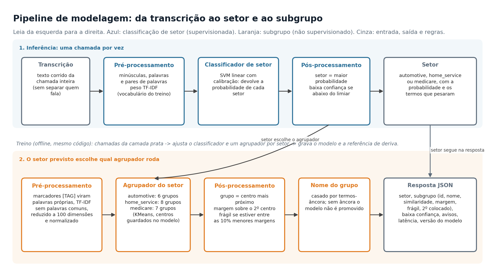

# Arquitetura

**Estilo:** monolito modular com tarefas em lote agendadas. Uma API síncrona (requisição e resposta) atende o usuário; todo o resto é lote. Sem microsserviços, sem fila de eventos e sem Kubernetes, e o motivo de cada ausência está em [ADR 0005](../adr/0005-estilo-de-arquitetura.md) e [ADR 0015](../adr/0015-kubernetes-nao-adotado.md).

| Diagrama | Pergunta que responde |
|---|---|
|  [`pipeline-de-modelagem.png`](pipeline-de-modelagem.png) | o que acontece com uma transcrição até virar setor e subgrupo? |
| [`plataforma.png`](plataforma.png) | quais peças existem e como conversam? |
| [`dados-em-camadas.png`](dados-em-camadas.png) | por onde os dados passam do arquivo ao painel? |
| [`ciclo-de-vida-do-modelo.png`](ciclo-de-vida-do-modelo.png) | como um modelo novo entra em produção? |

Os diagramas são gerados por `tools/build_diagrams.py` (`make diagrams`).

## Como as camadas do código se encaixam

```
frontend/ ──HTTP──▶ backend/app/routers ──▶ services ──▶ call_segmenter.models (modelo em memória)
                                      └────▶ call_segmenter.warehouse (repositório) ──▶ PostgreSQL (ops)

callseg (CLI) ──▶ call_segmenter.pipelines.steps ──▶ data, warehouse, training, monitoring
Airflow ──agenda──▶ callseg
```

A regra de dependência é de cima para baixo: o modelo não conhece web nem banco; a API conhece o modelo e o repositório; os pipelines conhecem tudo o que precisam. Nada importa a API.

## Modelo de dados

Quatro esquemas no mesmo PostgreSQL (ver [ADR 0009](../adr/0009-dados-em-camadas.md)):

| Esquema | Tabelas | Quem escreve | Quem lê |
|---|---|---|---|
| `bronze` | `raw_transcripts` | ingestão | ingestão |
| `silver` | `calls`, `quality_issues` | ingestão | treino, avaliação, agregados |
| `gold` | `sector_profile`, `size_histogram`, `dataset_versions`, `model_versions`, `holdout_confusion` e as visões do BI | ingestão, avaliação, promoção | Metabase, API (não), pessoas |
| `ops` | `predictions`, `shadow_predictions`, `drift_checks`, `model_benchmark` | API e pipelines | Metabase, deriva |

O esquema é definido por modelos ORM (`warehouse/models.py`) e criado por migrações Alembic.
